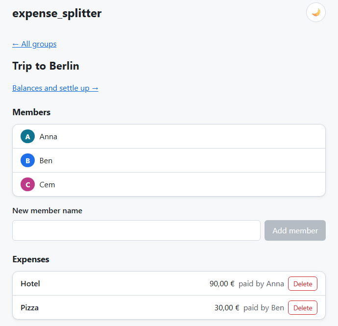
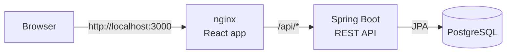
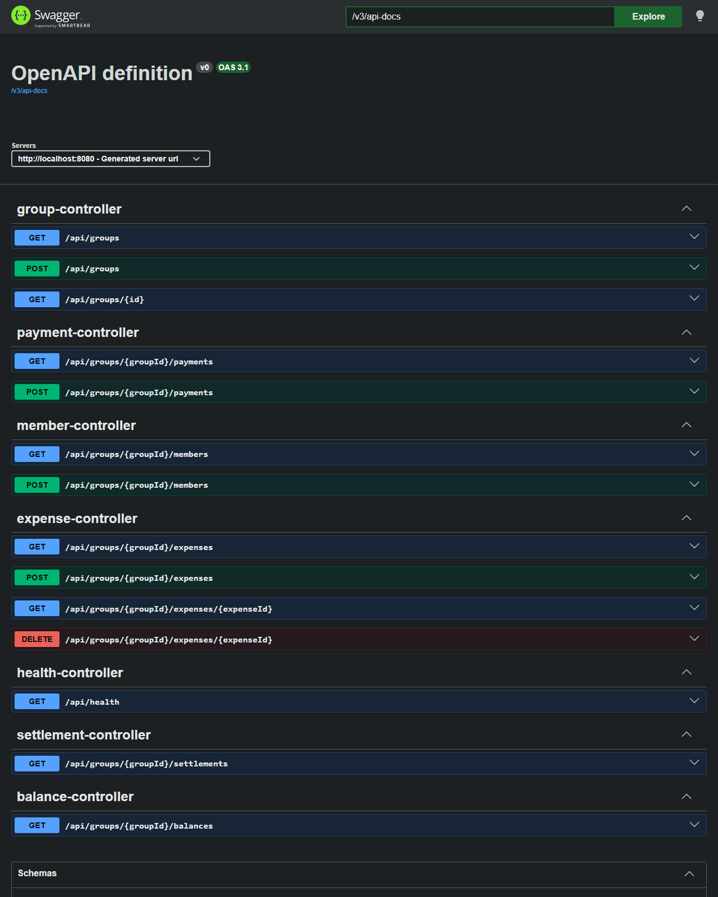

# expense_splitter

[](https://github.com/eastezz/expense_splitter/actions/workflows/ci.yml)

A full-stack web app for splitting group expenses, inspired by apps like Settle Up or Splitwise. You add the people in a group and what each of them paid, and the app shows who owes how much and which transfers settle everything up.

**Tech stack:** Java 21, Spring Boot 4, Spring Data JPA, PostgreSQL 17, Flyway, React 19, TypeScript, Vite, nginx, Docker Compose, GitHub Actions.

| A group with its members and expenses | Balances and suggested transfers |
|---|---|
| <picture><source media="(prefers-color-scheme: dark)" srcset="assets/web-group-dark.png"></picture> | <picture><source media="(prefers-color-scheme: dark)" srcset="assets/web-balances-dark.png"></picture> |

The app has a light and a dark theme: it follows the setting of your phone or computer, and the button in the top right switches it by hand. A short message confirms every action, deleting an expense asks first, and the pages fade in with grey placeholders while data is loading.

## Run it

The whole app (PostgreSQL, the Spring Boot backend and the React frontend) starts with one command. You only need [Docker Desktop](https://www.docker.com/products/docker-desktop/).

```powershell
docker compose up --build
```

Then open http://localhost:3000. The backend is also reachable directly at http://localhost:8080/swagger-ui.html. Stop everything with `docker compose down`.

- The data is stored in the Docker volume `db-data`, so it survives `docker compose down` and a restart. `docker compose down -v` deletes it.
- To use your own database password, copy `.env.example` to `.env` and change the values there. `.env` is ignored by Git.

## Example: settling a trip

Anna, Ben and Cem go on a trip. Anna pays 90 EUR for the hotel and Ben pays 30 EUR for pizza, both split equally by three. The app shows these balances (positive = gets money back, negative = owes money):

| Member | Paid | Share | Balance |
|---|---:|---:|---:|
| Anna | 90 | 40 | +50 |
| Ben | 30 | 40 | -10 |
| Cem | 0 | 40 | -40 |

It suggests two transfers to settle up:

- Cem pays Anna 40 EUR
- Ben pays Anna 10 EUR

After both transfers are marked as paid, every balance is 0 and there are no transfers left to suggest.

## How it works



nginx serves the built React app and forwards every request under `/api` to the Spring Boot backend, so the browser talks to a single address. The backend stores everything in PostgreSQL. Each part runs in its own Docker container.

- Money is stored as whole cents in a `long`, never as floating point, so there are no rounding errors.
- An equal split gives the leftover cents to the members with the smallest ids: 1000 cents split by three is 334 / 333 / 333. An exact split must add up to the total, otherwise the request is rejected.
- A member's balance is what they paid minus their share, plus the payments they sent minus the payments they received. The balances of a group always add up to 0. They are calculated on every request and never stored, so they can't get out of sync.
- Settle-up is greedy: the biggest debtor pays the biggest creditor until everyone is at 0. This needs at most n-1 transfers for n members. It is not always the absolute minimum, because finding that is NP-hard.
- The tables are created by the Flyway migrations in [db/migration](backend/src/main/resources/db/migration). Hibernate only checks that they match the entities (`ddl-auto=validate`), so the schema can't drift away from the code.
- Errors are returned as ProblemDetail (RFC 9457) JSON.

The key code is in [SplitCalculator.java](backend/src/main/java/io/github/eastezz/fairshare/expense/SplitCalculator.java), [BalanceCalculator.java](backend/src/main/java/io/github/eastezz/fairshare/settlement/BalanceCalculator.java) and [SettlementCalculator.java](backend/src/main/java/io/github/eastezz/fairshare/settlement/SettlementCalculator.java).

## Development without Docker

Start the backend (you need JDK 21 or newer; Maven is not needed, because the project ships the Maven wrapper):

```powershell
cd backend
.\mvnw.cmd spring-boot:run
```

Then start the frontend in a second window (you need Node.js 22 or newer):

```powershell
cd frontend
npm install
npm run dev
```

Open http://localhost:5173. Vite reloads the page on every change and forwards `/api` to the backend on port 8080. On macOS or Linux, use `./mvnw` instead of `.\mvnw.cmd`.

This way the backend uses an in-memory H2 database in PostgreSQL mode, so the data is gone after a restart. To use the PostgreSQL from Docker instead, start only the database with `docker compose up -d db` and run the backend with `$env:SPRING_PROFILES_ACTIVE="postgres"; .\mvnw.cmd spring-boot:run`.



## Endpoints

| Method | Path | What it does |
|---|---|---|
| GET | `/api/health` | Health check |
| POST | `/api/groups` | Create a group |
| GET | `/api/groups` | List all groups |
| GET | `/api/groups/{id}` | Get one group |
| POST | `/api/groups/{groupId}/members` | Add a member to a group |
| GET | `/api/groups/{groupId}/members` | List the members of a group |
| POST | `/api/groups/{groupId}/expenses` | Add an expense (split `EQUAL` or `EXACT`) |
| GET | `/api/groups/{groupId}/expenses` | List the expenses of a group |
| GET | `/api/groups/{groupId}/expenses/{expenseId}` | Get one expense |
| DELETE | `/api/groups/{groupId}/expenses/{expenseId}` | Delete an expense |
| GET | `/api/groups/{groupId}/balances` | Balance of every member |
| GET | `/api/groups/{groupId}/settlements` | Suggested transfers to settle up |
| POST | `/api/groups/{groupId}/payments` | Record a payment between two members |
| GET | `/api/groups/{groupId}/payments` | List the payments of a group |

## Tests

```powershell
cd backend
.\mvnw.cmd verify
```

The 67 backend tests check the split rounding, the balances, the settle-up (including a property test over 500 random groups), every endpoint with MockMvc including the error cases, and an end-to-end test that pays all suggested transfers and ends with every balance at 0.

```powershell
cd frontend
npm test
```

The 26 frontend tests use Vitest and React Testing Library. They render the pages with a fake backend and check what the user sees, for example the balances and the error messages.

GitHub Actions runs three jobs on every push to `main` and on every pull request: the backend tests, the frontend lint, tests and build, and a Docker build of both images.

## Roadmap

- [x] REST API for groups, members, expenses, balances, settle-up and payments
- [x] Tests and a GitHub Actions workflow that runs them
- [x] React frontend
- [x] PostgreSQL with Flyway and Docker Compose
- [ ] Login
