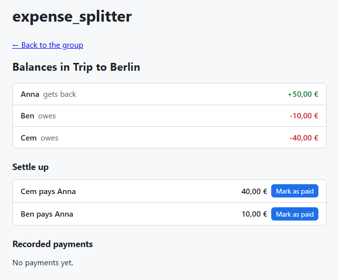
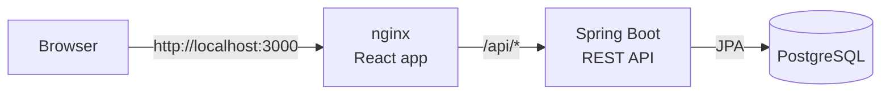

# expense_splitter

[](https://github.com/eastezz/expense_splitter/actions/workflows/ci.yml)

A full-stack web app for splitting group expenses, inspired by apps like Settle Up or Splitwise. You add the people in a group and what each of them paid, and the app shows who owes how much and which transfers settle everything up.

**Tech stack:** Java 21, Spring Boot 4, Spring Security, Spring Data JPA, PostgreSQL 17, Flyway, React 19, TypeScript, Vite, nginx, Docker Compose, GitHub Actions.

| A group with its members and expenses | Balances and suggested transfers |
|---|---|
| <picture><source media="(prefers-color-scheme: dark)" srcset="assets/web-group-dark.png"></picture> | <picture><source media="(prefers-color-scheme: dark)" srcset="assets/web-balances-dark.png"></picture> |

The app has a light and a dark theme: it follows the setting of your phone or computer, and the button in the top right switches it by hand. A short message confirms every action, deleting an expense asks first, and the pages fade in with grey placeholders while data is loading.

## Run it

The whole app (PostgreSQL, the Spring Boot backend and the React frontend) starts with one command. You only need [Docker Desktop](https://www.docker.com/products/docker-desktop/).

```powershell
docker compose up --build
```

Then open http://localhost:3000 and create an account. The backend is also reachable directly at http://localhost:8080/swagger-ui.html. Stop everything with `docker compose down`.

- The data is stored in the Docker volume `db-data`, so it survives `docker compose down` and a restart. `docker compose down -v` deletes it.
- To use your own database password, copy `.env.example` to `.env` and change the values there. `.env` is ignored by Git.

## Accounts and login

Everyone creates their own account, with an email and a password or with "Continue with Google", and only sees their own groups.

- Passwords are stored only as BCrypt hashes (salted and deliberately slow), never as text. A password needs at least 8 characters and at most 72 bytes, because BCrypt ignores everything after 72 bytes.
- After the login, Spring Security keeps the user in a server-side session. The browser only gets the session id, in an `HttpOnly` and `SameSite=Lax` cookie that JavaScript can't read. A new session id is created at every login (protection against session fixation).
- Every request that changes data needs a CSRF token: the backend puts it into the `XSRF-TOKEN` cookie, and the React app sends it back in the `X-XSRF-TOKEN` header. Other websites can't read that cookie, so they can't send requests in the user's name.
- Every endpoint under `/api` except `/api/health` and `/api/auth/**` needs a login and answers 401 without one. Another user's group answers 404, exactly like a group that doesn't exist, so nobody can find out which groups exist.
- A wrong email and a wrong password give the same answer, so nobody can find out which emails have an account.
- The sessions live in the backend's memory, so restarting the backend logs everybody out. The data stays.

### Continue with Google

"Continue with Google" uses Spring Security's OAuth 2.0 / OpenID Connect login. It is only switched on when a Google client is configured; without one, the button is hidden and everything else works the same.

- The first Google login creates an account without a password. If an account with the same email already exists and Google has verified that email, the Google account is connected to it, so both ways of logging in lead to the same groups. Next time the account is found by Google's id, even if the email at Google changed.
- After Google confirms who the person is, the backend logs that account in exactly like a password login, so all the rules above apply in the same way.

To switch it on for your own copy:

1. In the [Google Cloud Console](https://console.cloud.google.com/), open **Google Auth Platform**, set up the consent screen (type *External*, publishing status *Testing*) and add your Google account as a test user.
2. Under **Clients**, create an OAuth client of type *Web application* with the redirect URIs `http://localhost:3000/login/oauth2/code/google` (Docker) and `http://localhost:5173/login/oauth2/code/google` (Vite dev server).
3. Put its values into `.env` (see `.env.example`) and restart with `docker compose up --build`:

   ```
   GOOGLE_CLIENT_ID=...
   GOOGLE_CLIENT_SECRET=...
   ```

   `.env` is ignored by Git, so the secret never ends up in the repository. Without Docker, set both as environment variables before `.\mvnw.cmd spring-boot:run`.

## Install it as an app

expense_splitter is a Progressive Web App (PWA): it can be installed like a normal app, opens in its own window without the browser bar, and still opens without internet.

- **Android, Chrome or Edge:** click **Install app** in the header (it only appears when the browser offers an install).
- **iPhone and iPad:** a small hint explains it: tap the Share button and then **Add to Home Screen**.

How it works:

- [`manifest.webmanifest`](frontend/public/manifest.webmanifest) gives the app its name, colors and icons. The icons are made from [`icon.svg`](frontend/public/icon.svg): 192 and 512 px with rounded corners, a full-square 512 px "maskable" icon for Android, and a 180 px `apple-touch-icon.png` for iOS.
- The service worker [`sw.js`](frontend/public/sw.js) saves the app's own files (page, JavaScript, CSS, icons). Pages come from the network first and from the saved copy without internet; when nothing is saved yet, it shows [`offline.html`](frontend/public/offline.html). It never saves anything from `/api`, `/oauth2`, `/login/oauth2` or `/logout`, so data and logins always come fresh from the server.
- The service worker is only registered in the production build, not during `npm run dev`. nginx sends `sw.js`, `index.html` and the manifest with `Cache-Control: no-cache`, so an update is never stuck, and the hashed files in `/assets/` with a one-year cache.
- Installing needs HTTPS, except on `localhost`. On a phone it therefore only works once the app is online with HTTPS.

## Example: settling a trip

Anna, Ben and Cem go on a trip. Anna pays 90 EUR for the hotel and Ben pays 30 EUR for pizza, both split equally by three. The app shows these balances (positive = gets money back, negative = owes money):

| Member | Paid | Share | Balance |
|---|---:|---:|---:|
| Anna | 90 | 40 | +50 |
| Ben | 30 | 40 | -10 |
| Cem | 0 | 40 | -40 |

It suggests two transfers to settle up:

- Cem pays Anna 40 EUR
- Ben pays Anna 10 EUR

After both transfers are marked as paid, every balance is 0 and there are no transfers left to suggest.

## How it works



nginx serves the built React app and forwards every request under `/api` to the Spring Boot backend, so the browser talks to a single address. The backend stores everything in PostgreSQL. Each part runs in its own Docker container.

- Money is stored as whole cents in a `long`, never as floating point, so there are no rounding errors.
- An equal split gives the leftover cents to the members with the smallest ids: 1000 cents split by three is 334 / 333 / 333. An exact split must add up to the total, otherwise the request is rejected.
- A member's balance is what they paid minus their share, plus the payments they sent minus the payments they received. The balances of a group always add up to 0. They are calculated on every request and never stored, so they can't get out of sync.
- Settle-up is greedy: the biggest debtor pays the biggest creditor until everyone is at 0. This needs at most n-1 transfers for n members. It is not always the absolute minimum, because finding that is NP-hard.
- The tables are created by the Flyway migrations in [db/migration](backend/src/main/resources/db/migration). Hibernate only checks that they match the entities (`ddl-auto=validate`), so the schema can't drift away from the code.
- Errors are returned as ProblemDetail (RFC 9457) JSON.

The key code is in [SplitCalculator.java](backend/src/main/java/io/github/eastezz/fairshare/expense/SplitCalculator.java), [BalanceCalculator.java](backend/src/main/java/io/github/eastezz/fairshare/settlement/BalanceCalculator.java) and [SettlementCalculator.java](backend/src/main/java/io/github/eastezz/fairshare/settlement/SettlementCalculator.java).

## Development without Docker

Start the backend (you need JDK 21 or newer; Maven is not needed, because the project ships the Maven wrapper):

```powershell
cd backend
.\mvnw.cmd spring-boot:run
```

Then start the frontend in a second window (you need Node.js 22 or newer):

```powershell
cd frontend
npm install
npm run dev
```

Open http://localhost:5173. Vite reloads the page on every change and forwards `/api` to the backend on port 8080. On macOS or Linux, use `./mvnw` instead of `.\mvnw.cmd`.

This way the backend uses an in-memory H2 database in PostgreSQL mode, so the data is gone after a restart. To use the PostgreSQL from Docker instead, start only the database with `docker compose up -d db` and run the backend with `$env:SPRING_PROFILES_ACTIVE="postgres"; .\mvnw.cmd spring-boot:run`.


Swagger UI lists every endpoint. The ones that need a login only work there after logging in through the app, and requests that change data are refused, because Swagger UI doesn't send the CSRF token; use the app (or the tests) for those.

## Endpoints

Everything except `/api/health` and `/api/auth/**` needs a login, and a group can only be used by the user who created it.

| Method | Path | What it does |
|---|---|---|
| GET | `/api/health` | Health check |
| POST | `/api/auth/register` | Create an account (email and password) |
| POST | `/api/auth/login` | Log in; the answer sets the session cookie |
| POST | `/api/auth/logout` | Log out and end the session |
| GET | `/api/auth/me` | The logged-in user, or 401 |
| GET | `/api/auth/providers` | Whether "Continue with Google" is switched on |
| GET | `/oauth2/authorization/google` | Starts the Google login (a browser link, not a fetch) |
| POST | `/api/groups` | Create a group |
| GET | `/api/groups` | List your groups |
| GET | `/api/groups/{id}` | Get one group |
| POST | `/api/groups/{groupId}/members` | Add a member to a group |
| GET | `/api/groups/{groupId}/members` | List the members of a group |
| POST | `/api/groups/{groupId}/expenses` | Add an expense (split `EQUAL` or `EXACT`) |
| GET | `/api/groups/{groupId}/expenses` | List the expenses of a group |
| GET | `/api/groups/{groupId}/expenses/{expenseId}` | Get one expense |
| DELETE | `/api/groups/{groupId}/expenses/{expenseId}` | Delete an expense |
| GET | `/api/groups/{groupId}/balances` | Balance of every member |
| GET | `/api/groups/{groupId}/settlements` | Suggested transfers to settle up |
| POST | `/api/groups/{groupId}/payments` | Record a payment between two members |
| GET | `/api/groups/{groupId}/payments` | List the payments of a group |

## Tests

```powershell
cd backend
.\mvnw.cmd verify
```

The 106 backend tests check the split rounding, the balances, the settle-up (including a property test over 500 random groups), every endpoint with MockMvc including the error cases, and an end-to-end test that pays all suggested transfers and ends with every balance at 0. They also check the security rules: registration and BCrypt hashing, login, logout, 401 without login, 403 without CSRF token, that another user's group answers 404 on every endpoint, and the Google login with a made-up client (redirect to Google, new or connected account, unverified email).

```powershell
cd frontend
npm test
```

The 53 frontend tests use Vitest and React Testing Library. They render the pages with a fake backend and check what the user sees, for example the balances, the error messages, the login and register forms, that a visitor who isn't logged in is sent to the login page, the Install app button, the iPhone hint, and that the service worker is only registered in the production build.

GitHub Actions runs three jobs on every push to `main` and on every pull request: the backend tests, the frontend lint, tests and build, and a Docker build of both images.

## Roadmap

- [x] REST API for groups, members, expenses, balances, settle-up and payments
- [x] Tests and a GitHub Actions workflow that runs them
- [x] React frontend
- [x] PostgreSQL with Flyway and Docker Compose
- [x] Light and dark theme
- [x] Accounts with email and password; every user sees only their own groups
- [ ] Online with HTTPS and its own address
- [x] Continue with Google
- [x] Install it as an app on Android and iPhone (PWA)
